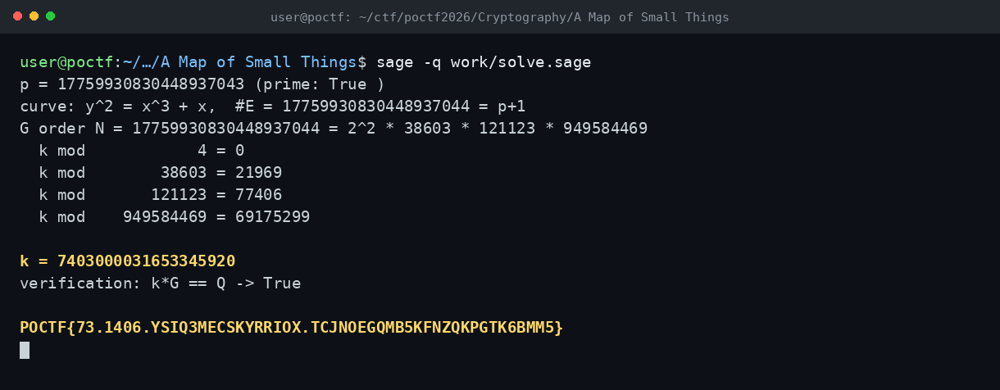

# A Map of Small Things — POCTF 2026 (CRYP 300, Wave 4)

Flag: POCTF{73.1406.YSIQ3MECSKYRRIOX.TCJNOEGQMB5KFNZQKPGTK6BMM5}
Private key: 7403000031653345920

Eğri y^2 = x^3 + x ve p = 17759930830448937043 idi. p sayısı 3 mod 4 olduğu için eğri supersingular ve iz 0, yani grup mertebesi p+1. p+1 de 2^2 * 38603 * 121123 * 949584469 şeklinde tamamen pürüzsüz. Bu yüzden Pohlig-Hellman ile her asal kuvvet için ayrık logları ayrı ayrı alıp CRT ile birleştirdim. k = 7403000031653345920 çıktı ve k*G == Q kontrolü doğruladı. Platformda ham anahtar kabul edildi.

