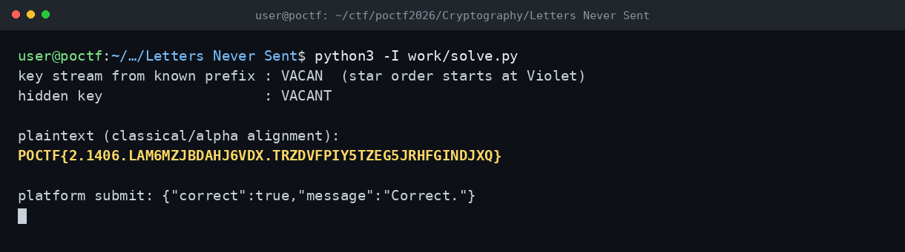

# Letters Never Sent — POCTF 2026 (CRYP 100, Wave 1)

Flag: POCTF{2.1406.LAM6MZJBDAHJ6VDX.TRZDVFPIY5TZEG5JRHFGINDJXQ}

Mektup, Admiral Sir Francis Beaufort ve "reciprocal tableau" ifadeleriyle Beaufort şifresine işaret ediyordu (C = K - P mod 26). Kenardaki altı yıldızın sırası Violet, Anchor, Carnation, Anchor, Narcissus, Tulip kelimelerini veriyor, baş harfleri VACANT anahtarını oluşturuyordu. Şifreli metni bu anahtarla çözdüm; harf olmayan karakterler korunuyor ve anahtar sadece harflerde ilerliyordu. Çıkan düz metin flag idi; platform submit ile de doğruladım.

