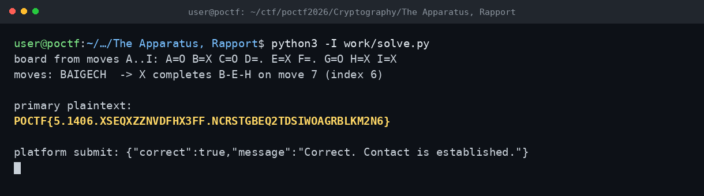

# The Apparatus, Rapport — POCTF 2026 (CRYP 300, Wave 2)

Flag: POCTF{5.1406.XSEQXZZNVDFHX3FF.NCRSTGBEQ2TDSIWOAGRBLKM2N6}

İpucu, kazanmış bir tic-tac-toe oyunundaki hamle sırasıydı. Tahtada X, B-E-H hattıyla 7. hamlede kazanıyordu; hamle sırası BAIGECH çıktı ve A..I harflerini 0..8 kaydırmasına çevirdi. Şifreleme, yazdırılabilir ASCII aralığında (space..~) toplamalı bir şifreydi. Bilinen POCTF{ önekiyle anahtar akışını doğrulayıp birincil ciphertext'i çözdüm. İkincil metin de aynı anahtarla anlamlı bir cümleye açıldı.

