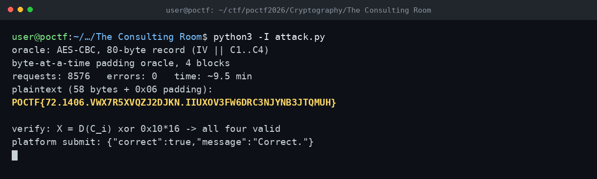

# The Consulting Room — POCTF 2026 (CRYP 200, Wave 3)

Flag: POCTF{72.1406.VWX7R5XVQZJ2DJKN.IIUXOV3FW6DRC3NJYNB3JTQMUH}

Elimizde 80 baytlık bir kayıt vardı: IV ve dört AES bloğu. Doğrulama uç noktası, verilen hex kayıt için sadece PKCS#7 padding'inin geçerli olup olmadığını söylüyordu; yani klasik bir CBC padding oracle. Blokları tek tek alıp bayt bayt D(C_i) değerlerini kurtardım. Her baytta bilinen kısımları doğru padding değerine sabitleyip adayı 0..255 arasında denedim; son baytta uzunluk-1 kontrolüyle false positive'i eledim. Dört blok açılınca düz metin ve flag ortaya çıktı. Ara değerleri 0x10*16 ile doğrulayınca dört blok da valid döndü.

