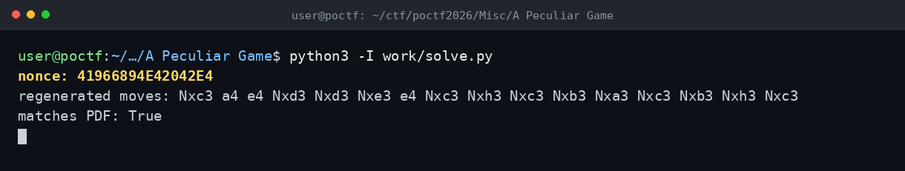

# A Peculiar Game — POCTF 2026

Nonce: 41966894E42042E4

PDF'teki satranç oyununda hamlelerin gittiği karelerin tamamı 3. ve 4. sıradaydı. Bunu 16 tuşlu bir hex klavye gibi okudum: her file için 3. sıra çift, 4. sıra tek sayıya denk geliyordu (a3=0, a4=1, b3=2, ... h4=F). Hamle sırasıyla kareleri hex'e çevirince nonce ortaya çıktı. Aynı nonce'tan hamleleri geri üretince PDF ile birebir eşleşti, yani okuma doğruydu.

