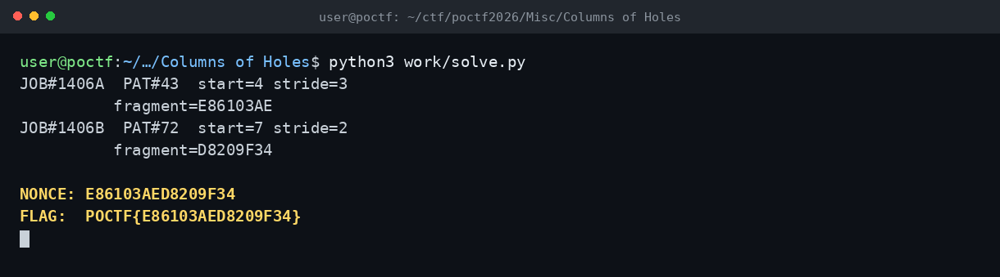

# Columns of Holes — POCTF 2026

Nonce: E86103AED8209F34

PDF'te iki punchcard ve bir memo vardı. Kart görüntülerini çıkarıp delikleri 80x12 Hollerith ızgarasına oturttum, sonra standart 80 kolonlu karakter setiyle çözdüm. Her kartta PAT#XY işareti vardı; X başlangıç, Y adım olacak şekilde 45-80 kolonları arasındaki payload'dan 8'er karakter aldım. A kartının parçası önce, B'nin parçası sonra gelince 16 karakterlik nonce tamamlandı.

