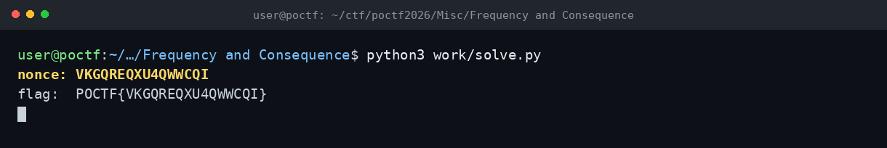

# Frequency and Consequence — POCTF 2026

Nonce: VKGQREQXU4QWWCQI

WAV dosyasında 0.5 saniyelik gürültünün ardından her biri 500 ms'lik 16 ton vardı. Her slot için 500 + 50*i Hz'lik 32 aday frekansı Goertzel ile taradım ve en yüksek enerjiyi veren indeksi base32 alfabesinde karaktere çevirdim. Çıkan 16 karakter nonce oldu.

