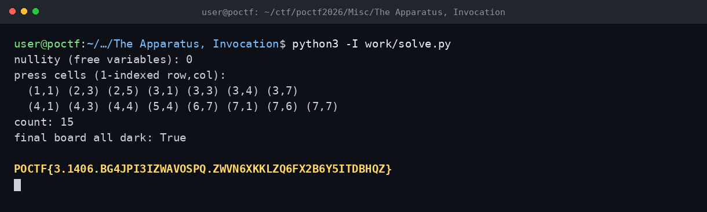

# The Apparatus, Invocation — POCTF 2026

Flag: POCTF{3.1406.BG4JPI3IZWAVOSPQ.ZWVN6XKKLZQ6FX2B6Y5ITDBHQZ}

7x7 ızgarada her basış kendisiyle birlikte dört komşusunu da çeviriyor ve hepsi sönünce flag geliyor. Bunu GF(2) üzerinde bir lineer denklem sistemi olarak yazdım: her hücre için kendisi ve komşularının basılma değişkenlerini toplayıp başlangıç durumuna eşitledim. Gauss eliminasyonuyla 15 basışlık çözüm çıktı ve tahta tamamen söndü.

