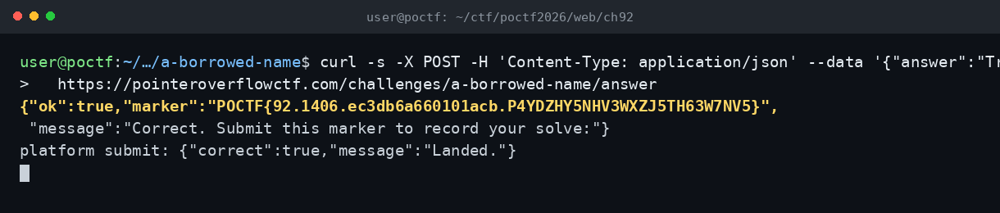

# A Borrowed Name — POCTF 2026 (OSINT 200, Wave 2)

Flag: POCTF{92.1406.ec3db6a660101acb.P4YDZHY5NHV3WXZJ5TH63W7NV5}

Sayfadaki özne Frank Abagnale Jr. idi. Soru, "Passwords are for treehouses!" sözüyle birlikte hangi şirkete danışman olduğunu soruyordu. Cybersecurity Ventures'ın makalesinde bu söz doğrudan passwordless kimlik doğrulama şirketi Trusona ile ilişkilendiriliyordu. Cevap Trusona olarak kabul edildi ve marker döndü.

