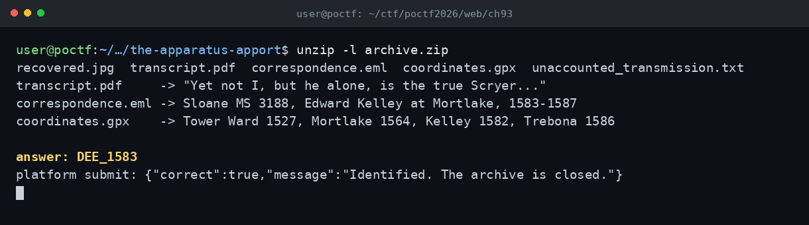

# The Apparatus, Apport — POCTF 2026 (OSINT, Wave 4)

Cevap: DEE_1583

Arşivde beş dosya vardı. Görselde obsidyen disk, heptagonal sigil ve 21x21 karakterli günlük; metinde Elizabeth dönemi bir matematikçi/astrolog ve Mortlake; yazışmada Sloane MS 3188 ve Edward Kelley; koordinatlarda Tower Ward, Mortlake ve Třeboň vardı. Hepsi John Dee'ye çıkıyordu. Biyografideki yılları denedim; 1527, 1582, 1564, 1586 ve 1587 reddedildi, 1583 kabul edildi (Sloane MS 3188 döneminin başlangıcı). Platform cevabı doğruladı.

