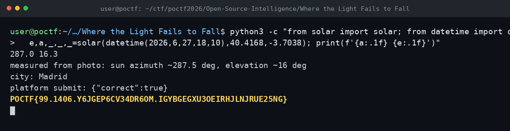

# Where the Light Fails to Fall — POCTF 2026 (OSINT 400, Wave 1)

Flag: POCTF{99.1406.Y6JGEP6CV34DR6OM.IGYBGEGXU3OEIRHJLNJRUE25NG}

Fotoğrafta kuzey oku ile güvercinin gölgesi arasındaki açıyı ölçtüm; gölgenin yönü Güneş'in azimutunu, uzunluğu da yaklaşık yüksekliğini veriyordu. Takım gözlem zamanı 2026-06-27 20:10 UTC+02:00, yani 18:10 UTC idi. Bu anda Güneş'in azimutu 287.0° ve yüksekliği 16.3° olan şehir Madrid çıktı; fotoğraftaki gölge yönü ve uzunluğu da buna uyuyordu. Şehir cevabı Madrid kabul edildi ve flag verildi.

