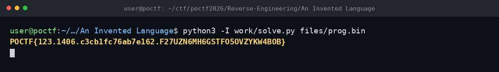

# An Invented Language — POCTF 2026

**Flag:** `POCTF{123.1406.c3cb1fc76ab7e162.F27UZN6MH6GSTFO5OVZYKW4BOB}`

## Özet

`vm.c` + `prog.bin`: özel ve dokümante edilmemiş bir instruction set. Program çalışınca çıktı vermiyor; flag'i VM belleğine yazıp duruyor.

- Bytecode, sabit uzunluklu opcode'lara ayrıldı (`PUSH` = `0x01` + 4 bayt).
- `PUSH a; PUSH b; XOR; PUSH idx; STORE` kalıpları yakalandı.
- Her kalıp `m[idx] = a ^ b` olarak çözüldü; bellek sırayla birleştirilince flag elde edildi.

## Terminal

