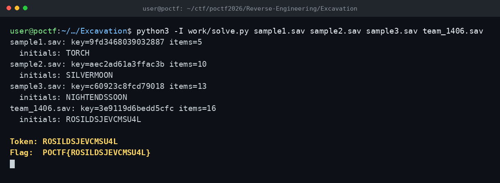

# Excavation — POCTF 2026 (iRE-100, Wave 1)

**Flag:** `POCTF{ROSILDSJEVCMSU4L}`

## Özet

Dört `.sav` dosyası: 12 baytlık başlık (magic `9e e1 c7 21`, sürüm/flags, u32 boyut), XOR'lu payload ve son 4 baytta CRC32.

- Payload, dosya başına **8 baytlık tekrar eden anahtarla** XOR'lu.
- Anahtar, tüm save'lerde ortak olan eşya katalog metinleriyle **known-plaintext** olarak kurtarıldı (metni ciphertext üzerinde kaydırıp `offset mod 8` tutarlılığını kontrol ederek).
- Envanter kayıtları ayrıştırıldı; eşya adlarının **ilk harfleri** token'ı verdi: `ROSILDSJEVCMSU4L`.

## Terminal

