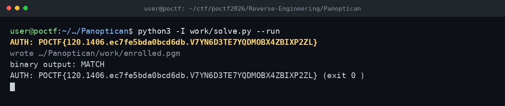

# Panoptican — POCTF 2026

**Flag:** `POCTF{120.1406.ec7fe5bda0bcd6db.V7YN6D3TE7YQDMOBX4ZBIXP2ZL}`

## Özet

İkili, girdi olarak `P5 32x32 maxval=255` PGM bekliyor. Enrolled template ile SSE ≤ 2000 ise `AUTH` satırı basılıyor.

- `.rodata`'daki 128 baytlık tablo ve 1024 baytlık template statik olarak alındı.
- `AUTH = table ^ template[:128]` → flag.
- Template aynı formatta PGM olarak verilince binary `MATCH` döndürdü.

## Terminal

