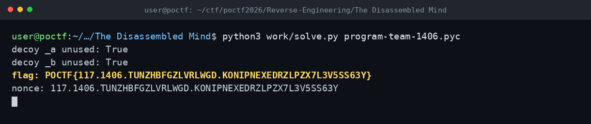

# The Disassembled Mind — POCTF 2026

**Flag:** `POCTF{117.1406.TUNZHBFGZLVRLWGD.KONIPNEXEDRZLPZX7L3V5SS63Y}`

## Özet

`program.pyc`, Python 3.11+ bytecode'u. Dosya çalıştırılmadan `marshal.loads` + `dis` ile açıldı.

- `check()` fonksiyonunun `co_consts`'unda beş byte dizisi var.
- XOR döngüsü yalnızca üçünü kullanıyor: `enc1[i] ^ enc2[i] ^ key2[i]`.
- Diğer ikisi (`_a`, `_b`) hiç yüklenmiyor — decoy.
- Üç dizi XOR'lanınca flag doğrudan çıkıyor.

## Terminal

